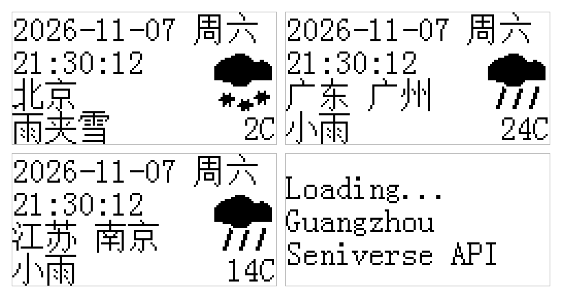

# ESP32 心知天气 OLED 桌面钟

一块 ESP32 + 0.96 寸 OLED 做的桌面天气显示屏：连上 WiFi 后从心知天气拉实时天气，屏幕上走真实时间、显示天气图标和温度，按一下按键换一座城市。



*图：左上北京 / 右上广州 / 左下南京 / 右下加载页 —— 由 `tools/render_mock.py` 用真实字模离屏渲染*

## 功能

- **四行信息**：日期星期 → 时间 + 天气图标 → 地区城市 → 天气文字 + 温度
- **每秒走字**：NTP 自动对时（东八区），只刷新时间所在区域，不闪屏
- **按键切城市**：短按下一座城市，长按立即刷新当前城市，每座城市有独立缓存（切换即时显示，不等联网）
- **自动刷新**：默认 10 分钟一次，失败 60 秒后重试
- **9 种天气图标**：32×32 单色点阵，晴 / 多云 / 阴 / 雨 / 雷 / 雪 / 雾 / 浮尘 / 大风
- **汉字按需生成**：字库里没有的字会显示成方框问号，所以配套了字模生成脚本

## 硬件

| 元件 | 说明 |
| --- | --- |
| ESP32 开发板 | 任意 ESP32-WROOM-32 板子，如 DevKit V1 |
| OLED 屏 | 0.96 寸 SSD1306，128×64，I2C 四针 |
| 轻触按键 | 4 脚轻触开关 1 个 |
| 杜邦线 | 若干 |

## 接线

| OLED / 按键 | ESP32 引脚 | 备注 |
| --- | --- | --- |
| VCC | **5V** | 见下方「注意事项」，接 3.3V 可能点不亮 |
| GND | GND | |
| SCL | GPIO22 | 硬件 I2C |
| SDA | GPIO21 | 硬件 I2C |
| 按键一端 | GPIO23 | 内部上拉，按下为低电平 |
| 按键另一端 | GND | |

> 四脚轻触按键要**跨接两侧**的脚（斜对角）。接到同一侧的两个脚上，按下永远不导通——这是最常见的接线错误。

## 快速开始

**1. 申请心知天气密钥**

到 [心知天气](https://www.seniverse.com/) 注册，控制台里添加一个 API 密钥。免费版有每日调用次数上限，10 分钟刷新一次（约 144 次／天）一般够用。

**2. 复制配置模板**

```bash
cp Config.example.h Config.h
```

然后编辑 `Config.h`，填入 WiFi 名称、密码和上一步拿到的密钥。`Config.h` 已在 `.gitignore` 中，不会被提交。

**3. 编译上传**

- Arduino IDE 2.x，开发板选 **ESP32 Dev Module**，其余选项保持默认
- 需要安装 ESP32 开发板支持包（测试版本 2.0.9），无需额外的第三方库，`Wire` / `WiFi` / `HTTPClient` 都是核心自带的
- 上传完成后打开串口监视器 **115200**，可以看到 WiFi、API、NTP 的运行日志

**4. 上电**

首次启动会显示 `Loading...`，约 2~5 秒后出画面。若显示 `WiFi FAIL`，检查 `Config.h` 里的账号密码；若显示 `Fetch Fail`，多半是密钥错误或当日额度用尽。

## 操作

| 操作 | 效果 |
| --- | --- |
| 短按（< 1.2 秒） | 切换到下一座城市 |
| 长按（≥ 1.2 秒） | 立即刷新当前城市 |

## 屏幕布局

```
+--------------------------------+
| 2026-11-07 周六                 |  日期 + 星期
| 17:57:12              [图标]    |  时间 + 32x32 天气图标
| 湖北 武汉                       |  地区 + 城市
| 小雨                     15C    |  天气文字 + 温度
+--------------------------------+
```

全屏使用 8×16 点阵字体（ASCII 每字符 8 像素宽，一行最多 16 个字符，超出会被屏幕边缘裁掉）。

## 改城市

城市表在 `Weather.cpp` 顶部：

```cpp
const CityInfo CITIES[] = {
    { "北京", "Beijing",   "",     "39.91:116.40" },  // 0 默认；直辖市 region 留空
    { "广州", "Guangzhou", "广东", "23.13:113.26" },
    ...
};
```

四个字段依次是：中文名、英文名（只用于加载提示和串口日志）、地区（空串表示直辖市，屏幕上不重复显示）、查询坐标。城市数量由数组长度自动推算，加行即可，不用改别处。

**坐标怎么写**：格式是 `纬度:经度`，填**市政府或市中心**，两位小数足够（0.01° ≈ 1.1 km）。不要填行政区划范围的边缘——接口会把坐标吸附到最近的**区县**气象站，填偏了会取到隔壁县市的数据，而屏幕上仍然显示你写的城市名，不容易发现。改完看串口日志可以核对：

```
[API] 坐标 39.91:116.40 → 解析到：北京
```

名字不一致时会追加提示 `<< 与城市表不符，请检查经纬度`。

**汉字要先有字模**：中文字库是预先烧进固件的点阵表，字库里没有的字会显示成方框问号。新增城市前先把缺的字加进 `tools/cn_chars.txt`（每行一个，省份名里的字也要算），再按下面顺序重新生成：

```bash
cd tools
powershell -ExecutionPolicy Bypass -File gen_assets.ps1 -Task font   # 生成字模
python merge_glyphs.py                                               # 合并进 OLED_Data.cpp
```

`merge_glyphs.py` 是幂等的，重复执行不会重复插入。字模生成用 Windows GDI + 宋体 16 像素，需要在 Windows 上跑。

## 项目结构

```
.
├── exp11_oled_weather.ino   主程序：初始化、按键、刷新调度、界面绘制
├── Config.h                 本机配置（不进仓库，由 Config.example.h 复制而来）
├── Config.example.h         配置模板
├── Weather.h / .cpp         城市表、HTTPS 请求、JSON 解析、天气代码映射
├── WeatherIcon.h / .cpp     9 个 32x32 天气图标点阵
├── OLED.h / .cpp            SSD1306 驱动（硬件 I2C）
├── OLED_Data.h / .cpp       字库：ASCII 8x16 / 6x8，汉字 16x16
├── docs/preview.png         README 用的预览图
└── tools/
    ├── cn_chars.txt         需要字模的汉字清单
    ├── gen_assets.ps1       生成汉字字模 + 天气图标 + 预览图
    ├── merge_glyphs.py      把生成的字模合并进 OLED_Data.cpp
    ├── render_mock.py       PC 端离屏模拟屏幕，验证排版用的
    └── cap_serial.ps1       抓串口日志的小工具
```

## 注意事项

**OLED 供电要用 5V，别用 3.3V。** SSD1306 模块点亮像素时电荷泵瞬时电流较大，ESP32 板载 3.3V 稳压器的余量可能带不动——症状是 I2C 握手正常（初始化命令全部 ACK），但一写显存就 NACK、屏幕全黑。把模块 VCC 改接到 5V 引脚即可（这类模块背面通常有 3.3V/5V 选择焊点，出厂在 3.3V 档，模块内部 LDO 会降到 3.3V，SDA/SCL 仍是 3.3V 电平，对 ESP32 安全）。

**WiFi 只支持 2.4GHz。** ESP32 连不上 5GHz 频段的热点，手机热点请开 2.4G 那个。

**免费额度。** 心知天气免费版有每日调用上限，刷新间隔不建议小于 10 分钟。

## 常见问题

| 现象 | 排查方向 |
| --- | --- |
| 屏幕全黑，串口日志正常 | OLED 供电，改接 5V（见上） |
| 屏幕一亮就掉线 / 花屏 | 同上，供电不足 |
| 汉字显示成方框问号 | 该字缺字模，加进 `cn_chars.txt` 后重新生成 |
| 连不上 WiFi | 是否 5GHz 热点；账号密码是否写对 |
| 时间显示 `--:--:--` | NTP 尚未同步或没有联网，联网后自动对上 |
| 温度明显不像本地 | 坐标精度只到区县，改用市中心坐标并看串口日志核对 |
| 每天固定时间开始 `Fetch Fail` | 免费额度用尽，第二天恢复 |

## 版权与致谢

- OLED 驱动（`OLED.cpp` / `OLED.h` / `OLED_Data.*`）来自 [江协科技](https://jiangxiekeji.com/)，版权归其所有，按其"免费开源共享、任何人不得据为己有"的条款使用，请保留文件头部的版权声明。
- 天气数据来自 [心知天气](https://www.seniverse.com/)，使用需自行申请密钥并遵守其服务条款。
- 本项目其余代码（`Weather.*`、`WeatherIcon.*`、`exp11_oled_weather.ino`）可自由参考、修改、取用。

仓库未附带开源许可证文件。若打算让他人自由使用，请自行选择并添加（如 MIT）。
